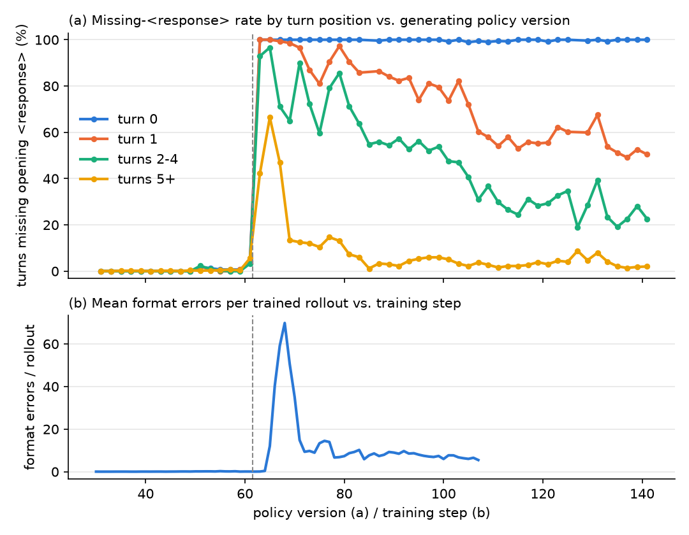

# A One-Token Format Flip Under a Lenient Agent Harness

*Research note: async RL on a Qwen3.5-9B terminal agent*

## Abstract

During asynchronous RL of a Qwen3.5-9B terminal agent (DPPO loss, binary outcome
reward, group size 12), the first reply of every episode switched, within one
policy update, from starting with the required `<response>` tag to starting
directly with `<analysis>`. The rate at which turn 0 is missing the tag went
from about 0-1% (policy versions up to 60) to 6/94 at version 61, then 77/77 at
version 62, and it stayed at 100% from then on. The harness re-asks on a parse
error, so a missing tag costs one turn and no reward. As a result the logged
format-error fraction went from 0.02-0.14 to about 1.0, while the held-out
Terminal-Bench 2.1 score did not move.

We confirm the flip sits in the trainer weights. A post-flip checkpoint
assigns p(`analysis` | `...</think>\n\n<`) ≈ 0.93, against ≈ 1e-6 for the base
model, and the trainer forward and vLLM agree on this value. We rule out a
prompt change, a corpus-specific cause, a restart, a batch anomaly, and a
length-correlated drift. Our main hypothesis is this. Under group-relative
advantages, a decision that every rollout makes identically gets zero net
gradient. The only net signal on such a decision comes from the rare samples
that deviate from it, and each of those carries roughly 1/p times more gradient
per sample. Because the lenient harness does not penalize the deviation,
off-format samples that still solved the task received positive advantage (12
of 15 in the seven steps before the flip, against 6.6 expected). Once the flip
happened, the trust-region mask and the log-ratio clamp keep it from reverting.
We also show that a single format-error counter mixes benign parser-strictness
slips with real degeneration. We describe the per-category metrics we added in
response.

## 1 Introduction

Agent harnesses usually parse a structured action format out of free text. They
then have to pick a policy for replies that do not parse. A *strict* harness
ends the episode, so the reward is zero. A *lenient* harness sends an error
message back and lets the model try again. Leniency seems harmless for RL: an
unparseable reply wastes a turn, and with an outcome reward a wasted turn costs
nothing unless it makes the episode run out of turns or time.

This note documents a case where leniency was not harmless in that sense. It
did not lower the score, but it let a single-token formatting decision drift and
eventually tip over in one update. The flip itself did little damage, since the
tag is cosmetic for our parser after one retry. What it shows is a general
interaction between outcome-only reward, group-relative advantages, and rare
tokens, and that interaction can just as easily move decisions that do matter.

## 2 Setup

**Policy and harness.** The policy is Qwen3.5-9B acting as a terminal agent in
the Terminus-2 XML action format (`<response><analysis>…</analysis><plan>…</plan>
<commands><keystrokes …>…</keystrokes></commands></response>`). It runs in
sandboxes from a cloud sandbox provider and is served by vLLM. The model emits
a thinking block and then the XML. When parsing fails (for example "No
<response> tag found"), the harness replies with "Previous response had parsing
errors: …" and the episode continues. A format error therefore costs one turn
and does not touch the reward.

**Training.** Training is asynchronous RL in torchtitan. The loss is DPPO, a
TMax-style recipe aligned with open-instruct, with these settings:

- the unclipped surrogate `−A · ratio`;
- a per-token total-variation trust-region mask with δ = 0.1, which zeroes
  tokens that already lie outside the region and are being pushed further out;
- the log-ratio clamped to ±10 before `exp`;
- `prompt_mean` aggregation, so each group's token losses are normalized by
  that group's token count;
- constant learning rate 3e-6;
- AdamW with betas (0.9, 0.999), eps 1e-8, no weight decay, and fp32 main
  weights.

Each prompt gets 12 rollouts. The reward is binary (task tests pass or fail),
and the advantage is A = r − mean(r) over the group, with no std normalization.
Policy version k means the weights produced by training step k. Rollouts
generated at version k are trained a few steps later.

**Data.** We use three sources:

- per-rollout records for every rollout of mixed-outcome groups trained at
  steps 40-70, 133 groups of 12 for steps 56-62;
- a rollout-sample log that keeps 2 of the 12 rollouts per group with full
  text, about 11k rollouts;
- the trainer's logged metrics.

## 3 The flip

*Figure 1. (a) Share of training-rollout turns whose reply does not start with
`<response>`, by turn position, against the policy version that generated the
turn (2-version bins, from the 2-of-12 sample log). (b) Mean format errors per
trained rollout against training step. Steps 108-139 are omitted because of a
duplicated logging segment. The dashed line marks the 61→62 update.*

| policy version | ≤ 49 | 50-59 | 60 | 61 | 62 | 63-68 |
|---|---|---|---|---|---|---|
| turn 0 missing `<response>` | 1 / 3720 | 7 / 710 | 0 / 43 | 6 / 94 | **77 / 77** | 432 / 432 |

At version 62 every turn-0 reply begins `<analysis>\n` and the rest of the
structure is intact. Across turn-0 replies from versions 62-69 (n = 573), the
other tags are almost always present: `</response>` in 98.9%, and
`<analysis>`, `<plan>`, `<commands>`, `</commands>` and `<keystrokes` in
99.8-100%. Only the opening `<response>` disappeared. Turns 1-4 jumped to 92%
at version 62 and close to 100% at 63-65. They then recovered partially, with
turn 1 settling at 49-61% from version 105 onward and turns 2-4 at about
20-40%. Later turns peaked at 66% and fell back to a few percent. Turn 0 never recovered, and
it was still at 99-100% at version 140.

Format errors per rollout peaked at about 70 (step 68), as the model repeated
the same opening across retries. RL then brought this down to 5-7 by steps
100-159, through the per-turn error feedback. The logged `format_error_frac`,
the fraction of rollouts with at least one error, went from 0.003-0.14 before
step 62 to 0.98-1.0 from step 68 on. Since turn 0 is always counted, that metric
carries no information after the flip.

**Effect on reward.** On held-out Terminal-Bench 2.1, run under the same
harness, the mean reward was 0.222 at version 0, 0.220 at 40, 0.222 at 82,
0.202 at 100 and 0.222 at 120, and pass@k was 0.393, 0.360, 0.360, 0.348 and
0.393. We see no change beyond noise. The in-training average reward was 0.52
over steps 41-61, dipped to 0.30 over steps 62-70 (minimum 0.17), which matches
the peak in errors per rollout, and averaged 0.38 over steps 71-159. That
comparison is confounded, because the training task pool is rewritten
continuously by a curriculum process that makes tasks harder. We therefore do
not read the drop as damage caused by the flip, and the held-out evaluation is
the cleaner signal.

**The decision is a single token.** `<response>` tokenizes as `<` (27) followed
by `response` (2246), and `<analysis>` as `<` followed by `analysis` (33340).
The flip is the choice of the second token at one position: right after
`</think>\n\n<` in turn 0. The same `response` token inside `</response>` was
unaffected.

**The flip is in the trainer weights.** We converted the step-144 checkpoint
and probed 24 real turn-0 contexts, cut right after `</think>\n\n<`. Each
context was evaluated in both the trainer forward and vLLM:

| weights | engine | p(`analysis` \| `<`) | p(`response` \| `<`) |
|---|---|---|---|
| base | trainer | 6.1e-7 (max 3.3e-6) | 1.00 |
| base | vLLM | 6.2e-7 | 1.00 |
| step 144 | trainer | 0.934 (0.907-0.975) | 0.0046 |
| step 144 | vLLM | 0.933 | 0.0044 |

The largest per-context gap between trainer and vLLM is 0.010 at step 144 and
4e-7 for the base model. So the flip is a property of the learned weights, not
of weight synchronization or the inference engine.

## 4 Ruling out alternatives

- **Prompt or template change.** The hash of the first 2.5k characters of the
  turn-0 prompt took one value across all ~10.1k sampled training rollouts,
  before and after the flip.
- **A corpus, or the rewritten tasks.** The pool mixes two task corpora, each
  containing both original tasks and versions rewritten by an LLM rewrite agent.
  Across versions 62-70, all four subsets flipped completely and at the same
  time (corpus A original 373/373 and rewritten 126/126, corpus B original
  74/74 and rewritten 70/70). Before the flip they sat at 0-2.4%.
- **Restart or code change.** The run has one restart, at step 84, which is 22
  steps after the flip.
- **A batch anomaly at steps 61-62.** The number of contributing groups (15
  and 18), the prompt_mean scale (6.2 and 4.1, inside the 2.4-12.2 range of
  steps 1-61), grad norm (0.058 and 0.055, inside the 0.05-0.14 range), the
  trust-region kept fraction (1.000) and the mean ratio (1.000) were all
  ordinary. We found no importance-ratio spike.
- **Length-correlated boilerplate drift.** Every turn emits `<response>`, and
  failed rollouts are longer (59.5 against 48.9 turns over versions 1-61), so
  per-turn tokens get a small net negative push. That push is real: the
  advantage-weighted turn count Σ A·n / Σ |A|·n = −0.11, t = −4.3. It does not
  explain the flip, for three reasons:
  - it is uniform: the token-weighted value is also −0.11, so it would act on
    every per-turn tag, and `</response>`, `<plan>` and the others did not
    move;
  - it was at its weakest just before the flip (versions 50-61: t = −1.1);
  - it does not reach turn 0, which appears exactly once per rollout. Under
    prompt_mean the turn-0 coefficients A_i / (G · T_g) sum to zero within each
    group.

## 5 Mechanism (main hypothesis)

**Zero net signal on a unanimous decision.** In a group, every rollout takes
the turn-0 decision, and almost all of them take it the same way. The sum of
advantages over a group is zero by construction. So the summed push on
`<response>`-at-turn-0 is about zero whatever the outcomes are. The only
asymmetric contribution comes from the rare rollouts that chose differently.

**Rare tokens carry outsized per-sample gradient.** The gradient of
log p(y) with respect to the logit of y is 1 − p(y). A sample that emitted
`analysis` when p ≈ 0.01 pushes that logit with weight ≈ 0.99·A. A sample that
emitted `response` when p ≈ 0.99 pushes its own logit with only ≈ 0.01·A. Each
deviation therefore gets about 100 times the leverage of a conforming sample.

**The lenient harness lets deviations win.** A rollout that drops the tag at
turn 0 is re-asked, recovers, and can still solve the task, which gives it a
positive advantage. In the full per-rollout records for steps 56-62, there are
15 rollouts whose turn 0 was a no-`<response>` reply starting with `<analysis>`
and whose advantage was non-zero:

| step | 56 | 57 | 58 | 59 | 60 | 61 | 62 | total |
|---|---|---|---|---|---|---|---|---|
| A > 0 | 3 | 1 | 1 | 1 | 3 | 2 | 1 | **12** |
| A < 0 | 0 | 0 | 0 | 1 | 1 | 1 | 0 | **3** |

If dropping the tag were unrelated to solving, each of these rollouts would
have A > 0 with probability equal to its group's solve rate. That predicts
6.6 ± 1.6 positives (6.1 ± 1.6 leaving the rollout itself out), so 12 is
z ≈ 3.3 (3.7). For each of the seven steps, the prompt_mean-weighted net
coefficient on these turn-0 samples was positive. A concrete case is step 60,
group g2061. The only solver among 12 rollouts is r1, whose turn 0 dropped
`<response>`, and it gets A = 1 − 1/12 ≈ +0.92. That sample alone pushes
`analysis`-after-`<` with roughly 0.92 × 0.99 weight. Earlier steps show
nothing comparable: steps 44-51 have zero such turn-0 samples, and steps 52-55
have three positive and four negative.

**The optimizer integrates it.** Adam normalizes each coordinate by its
running RMS. A small gradient of persistent sign therefore produces steps close
to the full learning rate, and β1 = 0.9 momentum carries them across steps.
The global grad norm was about 0.05 and never clipped, so clipping offered no
protection. We infer, but did not measure, that this let a few positive-advantage
samples per step build up a large logit change over seven steps.

**The size of the jump.** The max |trainer − generator| logprob difference on
trained tokens was 11-17 nats at steps 63-67. This block ends exactly when
tokens generated at versions ≤ 61 leave the batch: such rollouts make up 64, 52,
20 and 14 of the 64 sampled rollouts at steps 64-67, and 0 from step 68 on. We
read it as the trainer, now flipped, scoring stale pre-flip `<response>`
tokens. That implies the step-62 update moved this logit by ≳ 14 nats. This is
an inference, because the metric is a max over all tokens. By step 144 the
probe gives log p(`response` | `<`) ≈ −5.4, so the gap had narrowed somewhat,
or the max was set by other tokens. An earlier block (steps 56-58, 24-36 nats)
likewise ends exactly when tokens from versions ≤ 52 leave the batch. That
suggests an earlier, partial move of a similar kind, which we have not traced
to a specific token.

**After the flip the state is absorbing.**

- Stale `<response>` samples with A < 0 have ratio ≪ 1 and lie far outside the
  TV region, so the DPPO mask zeroes them.
- Stale `<response>` samples with A > 0 have log-ratio < −10, so the clamp is
  active and their gradient is exactly zero.
- New samples all share `<analysis>`, so there is no contrast left to push back.

Later turns did recover partially (Figure 1), because the error message
re-states the format and conforming retries out-solve looping ones. Turn 0
comes before any feedback, so it gets no such signal.

## 6 Format-error taxonomy

We classified every counted error turn in the sample log. After the flip that
is 57,977 of 358,687 training turns. Before it, the count was 604 of 230,342.

| category (post-flip training turns) | share | next-turn recovery |
|---|---|---|
| wrapper missing, actions otherwise valid | 57.3% | 20% |
| wrapper missing and malformed | 9.2% | 22% |
| `</commands>` unclosed | 12.0% | 59% |
| stopped after `<plan>` (no `<commands>`) | 6.6% | 82% |
| commands without `<keystrokes>` (silent no-op) | 5.8% | 19% |
| degenerate (empty / < 25 chars / highly repetitive) | 4.9% | 31% |
| plain prose, no XML | 1.8% | 64% |
| empty `<commands>` | 1.7% | 56% |

About 70% of post-flip error turns, the first and third rows, are slips of a
strict parser. A more tolerant parser would have executed the same actions.
The rest are a mix of benign slips and real degeneration: empty-command loops,
garbage replies (40% of the degenerate turns repeat the previous reply
verbatim), and **silent no-ops**. A silent no-op is `<commands>` holding a bare
command or a misspelled tag but no `<keystrokes>`. The upstream parser returns
neither an error nor a warning for it, so the turn runs nothing and the model
is never told why. In validation, silent no-ops had a 2.9% next-turn recovery
and a mean error streak of about 340 turns. One counter cannot tell these
cases apart. It also misses degeneration that parses cleanly: in validation,
13 rollouts repeated the same valid reply at least 5 times in a row, and every
one of them scored 0.

In response we added three things:

- a per-category label for each counted error turn (missing_wrapper,
  plain_text, no_commands, empty_commands, silent_noop, degenerate, truncated,
  other);
- per-rollout counts of the opening and longest error streaks, the
  repeated-reply fraction (valid turns included) and truncated turns;
- a parser warning for the silent no-op, sent through the same channel as the
  existing empty-commands warning.

The original counter is unchanged.

## 7 Discussion

A lenient harness combined with an outcome-only reward can make a rare format
deviation reward-neutral, or even reward-positive when the deviating rollout
happens to solve the task. Group-relative advantage then gives such
low-probability choices outsized leverage. Here that showed up as a slow drift
in a single-token decision that finally tipped over in one update. The same
dynamics apply to any decision that is nearly unanimous inside a group and
invisible to the reward.

There are clean remedies at the level of the environment:

- **Make the rule strict.** End the episode on a format error, as
  open-instruct and the TMax recipe do. Then an off-format sample cannot win,
  and its advantage is negative whenever its group has any solver.
- **Make the parser tolerant.** Accept the actions without the wrapper. Then
  the deviation is harmless, and the policy is free to drift on it.
- **Monitor per position and per category.** A single error rate saturates and
  mixes benign slips with degeneration. A turn-0 missing-tag rate would have
  shown the drift, from 1 of 3,720 to 7 of 710 to 6 of 94, before it saturated.

We considered and rejected reward shaping, meaning a per-format-error penalty
on the advantage. It changes the objective being optimized, it mixes a
formatting term into a binary task reward, and it cannot act once a group is
unanimous: if every rollout makes the same error, the penalty is the same for
all of them and cancels out of a group-relative advantage.

## 8 Limitations

- **The causal link is inferred.** We show that off-format turn-0 samples were
  significantly more often advantaged than chance, and that the net push on
  that decision was positive at every step from 56 to 62. We do not show that
  these 15 samples caused the flip. No per-token logprobs were stored for these
  steps, and checkpoints from before the flip had been rotated away. The only
  checkpoint we could probe is from step 144.
- **The decisive tests were not run.** They are: (i) per-step checkpoints with
  a fixed-prompt probe of p(`response` | `<`) across steps 50-62; and (ii) a
  counterfactual replay of steps 56-62 with the off-format samples removed.
- **The size of the logit jump is a bound read from a max metric**, not a
  direct measurement on that token.
- **Sampling.** The sample log keeps 2 of the 12 rollouts per group. The
  advantage counts in Section 5 use the full per-rollout records. The rate
  plots and the taxonomy use the 2-of-12 log.
- **The in-training reward comparison is confounded** by the evolving task pool
  (Section 3).

## Reproducibility note

The analysis scripts are not in the repository. The measurements were:

1. Parse turn 0 of each logged training rollout and test whether the reply
   starts with `<response>`. Bin by the turn's maximum policy version, and
   repeat for turn positions 1, 2-4 and 5+.
2. From the full per-rollout records of mixed-outcome groups at steps 56-62,
   recompute A = r − mean(r), which matched the logged advantages on all
   1,182 checked rollouts. Count turn-0 no-`<response>` replies by the sign of
   A, and compare against the group-solve-rate expectation Σ p_g with variance
   Σ p_g(1 − p_g).
3. Render the turn-0 prompt with the chat template, append the logged thinking
   followed by `</think>\n\n<`, and read the next-token distribution from the
   trainer forward and from vLLM, for the base and step-144 weights.
4. Join the per-step `logprob_diff/max` with the minimum generation version
   among each step's trained rollouts.
5. Classify every counted error turn with the upstream Terminus-2 XML parser
   plus simple rules (wrapper re-insertion, closing-tag repair, length and
   compressibility thresholds).
